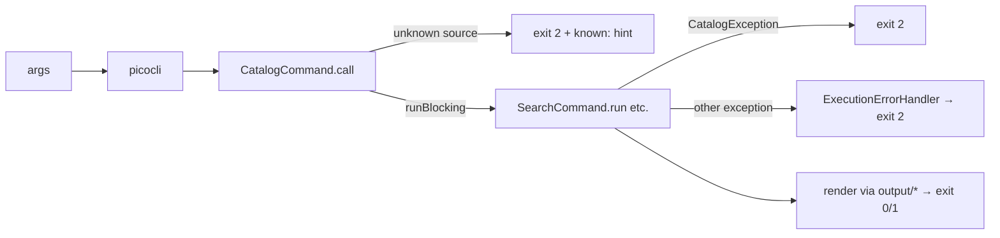

# CLI (`pixerion-cli`)

The command-line front-end: a thin picocli layer over `core`, shipped as a GraalVM
native binary. This page covers how the CLI is organized, its exit-code contract,
and the native-image constraints. The user-facing command reference is in the
[README](../../README.md#cli-usage).

## Layout

| File | Role |
|---|---|
| [`Main.kt`](../../pixerion-cli/src/main/kotlin/Main.kt) | Root `PixerionCommand`. Installs `ExecutionErrorHandler` and calls `exitProcess`. Lives in the **default package** so the entry class is `MainKt`. |
| [`command/CatalogCommand.kt`](../../pixerion-cli/src/main/kotlin/command/CatalogCommand.kt) | Base class for commands that need a catalog: the `-s/--source` option (default `mangadex`), registry lookup, the `runBlocking` bridge, and `CatalogException` → exit 2. Also parses refs (`scheme:id` or a bare id). |
| `command/SearchCommand.kt`, `FindCommand.kt`, `DownloadCommand.kt` | Catalog-backed subcommands |
| [`command/BundleCommand.kt`](../../pixerion-cli/src/main/kotlin/command/BundleCommand.kt) | Local-only. Not a `CatalogCommand`, and makes no network calls. |
| [`command/ExecutionErrorHandler.kt`](../../pixerion-cli/src/main/kotlin/command/ExecutionErrorHandler.kt) | Catch-all: any unhandled exception becomes a one-line error and exit 2 |
| [`output/`](../../pixerion-cli/src/main/kotlin/output/) | `BookView` (rendering a book), `DownloadProgressView` (live bars, a `DownloadProgress` listener), `Terminal` (styles, glyphs, colour detection) |

## Exit codes

Scripts depend on these, so treat them as API:

| Code | Meaning | Produced by |
|---|---|---|
| `0` | Success | command |
| `1` | Clean "no result" (empty search, `find` miss) | command |
| `2` | Usage error (unknown `--source`, bad args) **or** a failure (unreachable source, I/O) | `CatalogCommand`, picocli, `ExecutionErrorHandler` |

> **Why 1 and 2 are separate:** "nothing matched" is a successful answer that
> scripts often branch on. A failure must never look like it.

## How a command runs

**Test seam:** `CatalogCommand.catalogs` is an `internal var` resolver, which
defaults to `CatalogRegistry::get`. Tests replace it with a fake to drive a
command end-to-end (parse → run → render) without network access. See
[`command/Fixtures.kt`](../../pixerion-cli/src/test/kotlin/command/Fixtures.kt).

## Native image

- picocli's reflection metadata is generated at **build time** by
  `picocli-codegen` (kapt). Command classes must stay plain: no runtime reflection,
  no dynamic proxies.
- Metadata for third-party libraries (OkHttp, …) comes from the GraalVM
  reachability-metadata repository (`metadataRepository { enabled = true }`). There
  is no hand-written `reflect-config.json`.
- Build: `./gradlew :pixerion-cli:nativeCompile` → `pixerion-cli/build/native/nativeCompile/pixerion`.
- Native tasks are marked `notCompatibleWithConfigurationCache`. Expect a warning;
  you don't need any flags.
- **Toolchain trap:** without `GRAALVM_HOME`, Gradle auto-provisions GraalVM via
  Foojay, and that distribution ships a broken 0-byte `native-image` symlink. Install
  a real GraalVM (`sdk install java 25.0.2-graalce`) and export `GRAALVM_HOME`. See
  [Troubleshooting](../troubleshooting.md#native-image).
- CI builds native binaries for Linux x86_64, macOS arm64 and Windows x86_64 on
  merge (native images can't cross-compile). See [Release & artifacts](../workflows/release.md).

## Related

- [Core library](core.md) · [Architecture overview](overview.md)
- [ADR-0002: picocli for the CLI](../adr/0002-picocli-for-the-cli.md)
- [Back to the hub](../index.md)
