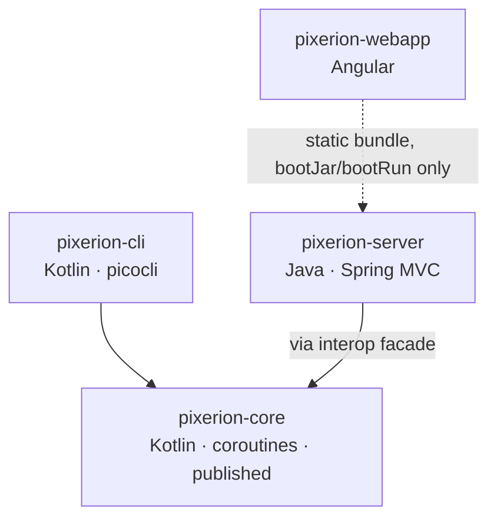
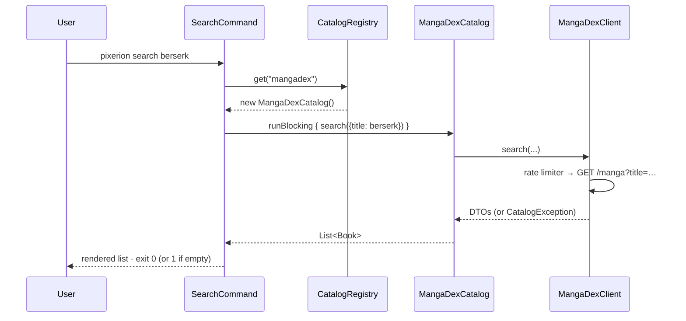
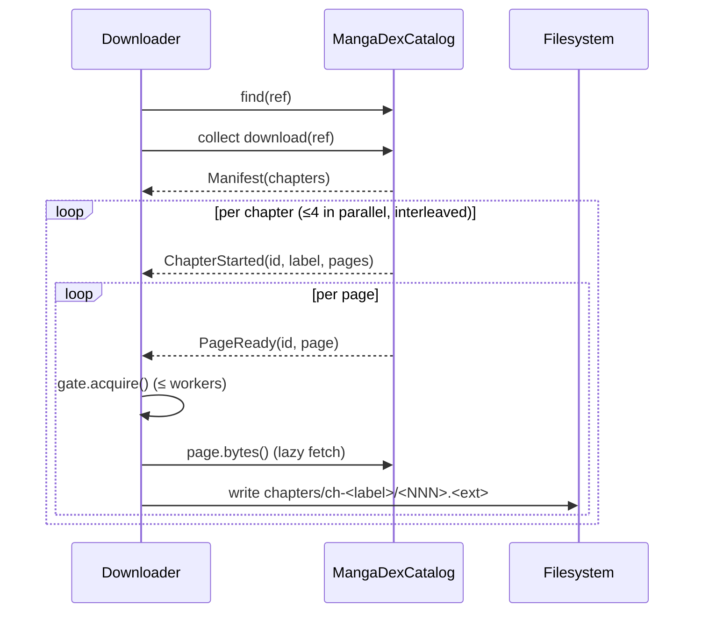
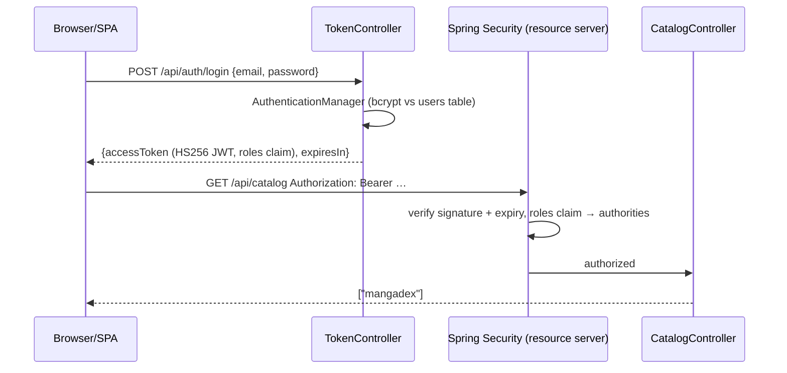

# Architecture overview

How Pixerion is put together, in one sitting. This page gives you the shape;
[`ARCHITECTURE.md`](../../ARCHITECTURE.md) holds the detailed invariants and
pitfalls, and each module has its own page (linked at the bottom).

## System context

```mermaid
flowchart LR
    user([Terminal user]) --> cli[pixerion CLI<br/>native binary]
    browser([Browser]) --> server
    subgraph server[pixerion-server · Spring Boot]
        spa[Embedded Angular SPA]
        api[REST API /api/**]
    end
    cli --> core[(pixerion-core<br/>library)]
    api --> core
    api --> pg[(PostgreSQL<br/>users & roles)]
    core -->|HTTPS, rate-limited| md[MangaDex API<br/>api.mangadex.org]
    core -->|image fetches| cdn[MangaDex@Home<br/>image nodes]
    core -->|writes| fs[(~/.pixerion<br/>pages & .cbz)]
```

Pixerion has only two external dependencies: the **MangaDex API and its image
CDN**, and **PostgreSQL**, which only the server uses and only for accounts. There
is no queue, no cache server, and no other service. Book data is never stored in
the database; a catalog is always an upstream source.

## Modules and the one rule



**Dependencies only point inward to `core`.** `cli` and `server` never depend on
each other, and `core` depends on neither. All reusable behaviour lives in `core`.
The front-ends turn input (CLI args, HTTP requests) into a `core` call and render
the result.

> **Why:** a second front-end (the server) was planned from the start. Keeping
> the logic in one library means a bug fix in download pacing or the absence-vs-failure
> rule applies to both front-ends at once, and the library can be published and
> reused on its own ([ADR-0005](../adr/0005-library-namespace-and-publishing-for-shared.md)).

| Module | Language | Ships as | Published |
|---|---|---|---|
| [`pixerion-core`](core.md) | Kotlin (coroutines) | jar `io.modernia.pixerion:pixerion-core` | yes (Maven local / GitHub Packages) |
| [`pixerion-cli`](cli.md) | Kotlin | GraalVM native binary + JVM distZip | no |
| [`pixerion-server`](server.md) | Java 25 | Spring Boot jar / Docker image | no |
| [`pixerion-webapp`](webapp.md) | TypeScript (Angular 22) | jar of static resources embedded in the server | no |

## The central abstraction: `Catalog`

Everything revolves around one port, [`Catalog`](../../pixerion-core/src/main/kotlin/io/modernia/pixerion/domain/Catalog.kt):

```kotlin
suspend fun find(ref: BookRef): Book?
suspend fun search(query: Map<String, String>): List<Book>
fun download(ref: BookRef): Flow<DownloadEvent>   // cold
```

Callers see only domain types and can't tell which source answered. Adapters
(today only MangaDex) implement it, and [`CatalogRegistry`](../../pixerion-core/src/main/kotlin/io/modernia/pixerion/source/CatalogRegistry.kt)
maps a source name (`"mangadex"`) to an adapter factory. See [Core](core.md) for
the contract rules.

## Key flows

### Search (CLI)



### Download



Three separate limits govern a download: chapter fan-out inside the adapter, the
write pool inside `Downloader`, and a global 5 requests/second rate limiter in the
HTTP client. The [download pipeline design note](../design/download-pipeline.md)
explains why each one exists.

### Login and authenticated request (server)



## Cross-cutting invariants (summary)

1. **Absence ≠ failure.** Not found is `null`/empty. A broken source throws `CatalogException`.
2. **`download` is cold and lazy.** Nothing happens until it's collected, and page bytes are fetched on demand.
3. **One registry.** Adding a source is one map entry. Front-ends render their "known sources" hints from it.
4. **One Java seam.** Java uses `interop.BlockingCatalog` and `interop.Refs`, never `suspend` code directly.
5. **One rate governor per adapter instance.** Long-lived front-ends must reuse adapters, not rebuild them per request (see [Server](server.md#catalog-api)).

The full rules and their failure modes are in
[`ARCHITECTURE.md` §2–§4](../../ARCHITECTURE.md#2-the-central-contract-catalog).

## Next

- [Core library](core.md) · [CLI](cli.md) · [Server](server.md) · [Webapp](webapp.md)
- [Decisions](decisions.md)
- [Back to the hub](../index.md)
