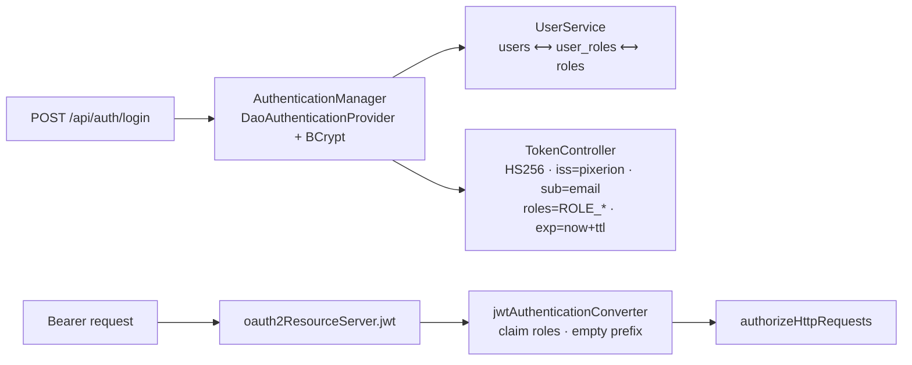

# Server (`pixerion-server`)

A Java 25 Spring Boot 4 (Spring MVC) backend: it issues JWTs, exposes a read-only
catalog API over `core`, and serves the Angular SPA. It is **deliberately built by
hand, as a learning exercise**, so expect work in progress and stubbed methods.
This page describes what is there today and the rules the existing code relies on.

> **Note:** the auth design is in
> [ADR-0015](../adr/0015-stateless-self-issued-jwt-auth.md), and its traps are in
> [`ARCHITECTURE.md` §4.8](../../ARCHITECTURE.md#48-the-server-auth-seam). For
> configuration and running it, see [Operations](../operations.md).

- [Layout](#layout)
- [Endpoints](#endpoints)
- [Security model](#security-model)
- [Catalog API](#catalog-api)
- [Persistence](#persistence)
- [Testing](#testing)
- [Current state](#current-state)

## Layout

Organized by **feature, then layer**: `io.modernia.pixerion.server.<feature>.<layer>`.

| Package | Contents |
|---|---|
| [`auth/controllers`](../../pixerion-server/src/main/java/io/modernia/pixerion/server/auth/controllers/) | `TokenController` (`POST /api/auth/login`), request/response records, `AuthExceptionHandler` |
| [`auth/models`](../../pixerion-server/src/main/java/io/modernia/pixerion/server/auth/models/) | `User`, `Role` JPA entities, and their Spring Data repositories |
| [`auth/services`](../../pixerion-server/src/main/java/io/modernia/pixerion/server/auth/services/) | `UserService` (`UserDetailsService`: user rows → authorities) |
| [`catalog/controllers`](../../pixerion-server/src/main/java/io/modernia/pixerion/server/catalog/controllers/) | `CatalogController`, `BookResponse` (wire DTO), `CatalogExceptionHandler` |
| [`catalog/services`](../../pixerion-server/src/main/java/io/modernia/pixerion/server/catalog/services/) | `CatalogService`: resolves a source and calls `BlockingCatalog` |
| [`catalog/components`](../../pixerion-server/src/main/java/io/modernia/pixerion/server/catalog/components/) | `CatalogSources` port + `RegistryCatalogSources` (delegates to `CatalogRegistry`) |
| [`catalog/exceptions`](../../pixerion-server/src/main/java/io/modernia/pixerion/server/catalog/exceptions/) | `UnknownSourceException` (→ 400), `BookNotFoundException` |
| [`config`](../../pixerion-server/src/main/java/io/modernia/pixerion/server/config/) | `SecurityConfig`, `JwtProperties`, `OpenApiConfig` |

## Endpoints

| Method & path | Access | Status |
|---|---|---|
| `GET /`, `/index.html`, `/favicon.ico`, `/*.js`, `/*.css`, `/assets/**` | public | SPA (served from the embedded webapp jar) |
| `GET /actuator/health` | public | container health check |
| `POST /api/auth/login` | public | returns `{accessToken, expiresIn}`. `400` on invalid input, `401` on bad credentials |
| `GET /v3/api-docs`, `GET /scalar` | public | OpenAPI document and the Scalar console |
| `GET /api/catalog` | bearer token | lists the source names (`["mangadex"]`) |
| `GET /api/catalog/{source}?id=…` | bearer token | `[book]` or `[]` |
| `GET /api/catalog/{source}?title=…` | bearer token | **stub** (`searchByTitle` is a TODO) |
| `/actuator/**` (other exposed endpoints) | `ROLE_ADMIN` | only `health` is exposed in the main config |
| anything else | denied | `401` without a token, `403` with one (never `404`) |

The interactive API reference is at `http://localhost:8080/scalar` when the server
is running. Requests ready to run in IntelliJ are in
[`pixerion-server/http/api.http`](../../pixerion-server/http/README.md).

## Security model

Stateless, self-issued JWT: the server is both the token issuer and the resource server.

Rules that look odd but are deliberate (details in
[`ARCHITECTURE.md` §4.8](../../ARCHITECTURE.md#48-the-server-auth-seam)):

- **Rule order matters.** `POST /api/auth/login` is `permitAll` *above* `/api/**`. If you reorder them, nobody can log in.
- **The rule list ends with `denyAll()`.** Any path that isn't explicitly classified is refused. When you add a route outside `/api/**`, add a rule for it too.
- **`ERROR`/`FORWARD` dispatches are permitted first.** Without this, `denyAll()` re-denies the container's `/error` forward and every 400 turns into an empty 401. MockMvc can't catch this, which is why `ErrorDispatchTest` runs on a real port.
- **The roles claim is shared (`SecurityConfig.ROLES_CLAIM`).** The inbound converter clears the default `SCOPE_` prefix. If the two sides disagree, tokens look valid and every role check fails silently.
- **Only `ROLE_*` authorities go into the token.** Spring Security 7 also grants `FACTOR_*` authorities, and those aren't roles.
- **Login errors are deliberately vague.** An unknown email and a wrong password return the same 401 body, so the endpoint can't be used to discover which accounts exist.
- **Tokens are short-lived (default 5 min) and can't be revoked.** The TTL is the only lever. There is no refresh token yet.
- **The CSP header is strict.** It is tuned for the SPA and Scalar (`fonts.scalar.com`). Loading a new external asset requires a CSP change in `SecurityConfig`.

## Catalog API

`CatalogController` → `CatalogService` → `CatalogSources` → `CatalogRegistry` → `BlockingCatalog`.

- **Read-only by design.** Catalogs are upstream sources, not data this server owns, so there are no write routes.
- **Absence is `200 []`, never `404`.** Lookup by id and search by title share one route (`/{source}`) and always return an array, so the frontend never has to branch on a status code to tell "not found" from an error.
- **Exactly one of `title` or `id`.** Neither or both is a `400`.
- **`source` is required, never defaulted.** The CLI defaults it because a human is typing; an API caller always knows which source it means.
- **Error mapping:** `UnknownSourceException` → `400` (a client mistake). `CatalogException` → `502 Bad Gateway`, because the upstream failed, not this server. Don't echo `CatalogException` messages back to the client, since they can contain upstream URLs.
- **Adapters must be long-lived.** `CatalogRegistry.get` builds a new adapter, with its own HTTP client and rate limiter, on every call. Building one per request would undo MangaDex rate limiting. `CatalogService` keeps a per-scheme `ConcurrentHashMap` cache for this reason.
- **`/api/catalog` reads the registry, not the cache.** The cache only holds sources somebody has already queried, so it is empty after a cold start.
- **`CatalogSources` is the test seam.** The registry is a Kotlin `object` and can't be stubbed, so tests replace this bean instead of calling MangaDex.
- `BlockingCatalog` blocks the request thread. That's fine under Spring MVC, but it would need rethinking under WebFlux.

## Persistence

- PostgreSQL 17. The schema is owned by **Flyway** ([`db/migration`](../../pixerion-server/src/main/resources/db/migration/)), and `ddl-auto=validate` stops startup if the entities and the schema drift apart.
- Tables: `users(id, email, password)`, `roles(id, name)`, `user_roles(user_id, role_id)`. Role names include the `ROLE_` prefix. Deleting a user cascades to their grants; deleting a role that is still held is refused.
- Migrations must run on **both Postgres and H2** (`GENERATED BY DEFAULT AS IDENTITY`, not `BIGSERIAL`), because the tests run the real migrations on H2.
- `open-in-view=false`, so `User.roles` is `EAGER`. JPA annotations go on **fields**, never getters.
- `V3__seed_admin.sql` seeds `admin@pixerion.local` / `changeme` (`ROLE_USER` and `ROLE_ADMIN`). It's for development only, and a real deployment must remove it.

> **TODO (owner to confirm):** how the dev seed is meant to stay out of a real
> deployment. Today it is an ordinary migration that runs everywhere. A
> Flyway `locations` per profile, or a `spring.flyway.placeholders` guard, are the
> usual options.

## Testing

| Test | What it pins |
|---|---|
| `ApplicationTests` | Context loads on H2 with the real migrations |
| `auth/SecurityRulesTest` | The authorization matrix (public / authenticated / ADMIN / denied) |
| `auth/ErrorDispatchTest` | Real-port test: error responses keep their status through `denyAll()` |
| `auth/TokenControllerTest` | Login success, wrong password, and unknown account are indistinguishable |
| `auth/UserRepositoryTest` | Entity ↔ schema mapping, role loading |
| `catalog/CatalogControllerTest` | Endpoint behaviour with a fake `CatalogSources`. **Currently `@Disabled`** until the catalog code is done. |

Test config lives in [`src/test/resources/application.properties`](../../pixerion-server/src/test/resources/application.properties),
which **replaces** the main file: H2 in PostgreSQL mode, a random DB per context,
and a test JWT secret. `:pixerion-server:test` never builds the frontend.

## Current state

This is a snapshot (2026-10, branch head `c7d05ce`). Update or delete it as the module moves.

- `CatalogService.searchByTitle` and the three `CatalogExceptionHandler` methods throw `UnsupportedOperationException`. Until they're implemented, a title search, an unknown source, or an upstream failure returns **500**.
- `CatalogService.catalogFor` creates a new `BlockingCatalog` on each call, and the `catalogs` cache field is never used, so the rate-limit concern described above isn't handled yet.
- `CatalogController` Javadoc refers to `/{source}/books`, but the mapping is `/{source}`.
- `BookNotFoundException` and its 404 handler are left over from the old `/{source}/{id}` route. Nothing throws it now.
- `TokenControllerTest.valid_credentials_yield_a_token` expects `expiresIn == 900`, but the test properties set `ttl=5m` (300). The test fails.
- Several comments cite ADR-0007 (the interop facade), ADR-0012 (springdoc/Scalar), and ADR-0013 (webapp bridge). None of these exist in `docs/adr/`.

## Related

- [Operations](../operations.md): configuration, Docker, health
- [Webapp](webapp.md) · [Core → Java interop](core.md#java-interop)
- [Back to the hub](../index.md)
