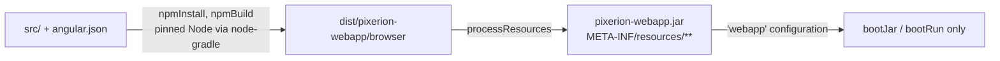

# Webapp (`pixerion-webapp`)

The Angular SPA and the Gradle↔npm bridge that packages it into the backend.
Today the app is a freshly generated Angular 22 scaffold. What already works is the
plumbing: building, embedding, and the development loop.

## Two ways to run it

| Purpose | Command | What happens |
|---|---|---|
| **Day-to-day frontend work** | `./gradlew :pixerion-webapp:run` or `cd pixerion-webapp && ng serve --proxy-config proxy.conf.json` | Hot-reloading dev server on `:4200`. [`proxy.conf.json`](../../pixerion-webapp/proxy.conf.json) forwards `/api`, `/auth`, `/actuator`, `/v3`, `/scalar` to `localhost:8080`. No jars are built. |
| **The shipped artifact** | `./gradlew :pixerion-server:bootRun` / `bootJar` | `npmBuild` → `dist/pixerion-webapp/browser` → packaged under `META-INF/resources/` in the webapp jar → added to the server classpath. Spring Boot serves it as static content. |

Any backend on `:8080` works for the dev loop: `bootRun` or the compose container.

## How the bridge works

Things to know before touching [`build.gradle.kts`](../../pixerion-webapp/build.gradle.kts):

- **Node is pinned and downloaded by Gradle** (`nodejs` in the version catalog), so the build never uses whatever `node` happens to be on `PATH`.
- **The Angular project name is load-bearing.** Gradle reads `dist/pixerion-webapp/browser`. Renaming the project in `angular.json` breaks packaging.
- **The server uses a dedicated `webapp` configuration, not `implementation`.** That keeps the SPA off the server's test classpath, so `:pixerion-server:test` never runs npm. Don't "simplify" it into a normal dependency.
- **A root `./gradlew test` or `build` still runs `npmBuild`**, because `:pixerion-webapp:test` depends on its own `processResources`. Scope your Gradle runs when you don't need the frontend.
- **All npm tasks skip when there is no `package.json`.** This let the module exist before the app was scaffolded.
- **Security:** `SecurityConfig` permits `GET` only on `/`, `/index.html`, `/favicon.ico`, `/*.js`, `/*.css`, and `/assets/**`. Anything else the bundle serves (for example `/media/**`, or deep links for client-side routes) is denied until a rule is added.

> **TODO (owner to confirm):** client-side routing needs a history-API fallback
> (unknown paths → `index.html`). A build comment mentions a `SpaConfig` for this,
> but no such class exists yet, and `denyAll()` would block deep links anyway.

## Angular conventions

[`pixerion-webapp/.claude/CLAUDE.md`](../../pixerion-webapp/.claude/CLAUDE.md)
holds the frontend style rules: standalone components, signals for state,
`input()`/`output()` functions, native control flow (`@if`/`@for`), `inject()`
over constructor injection, and AXE / WCAG AA accessibility as a hard requirement.
Prettier is configured in [`.prettierrc`](../../pixerion-webapp/.prettierrc).
Unit tests run on **Vitest** (`ng test`).

> **Note:** the frontend has no CI step yet. Neither `ng test` nor a lint runs in
> [`ci.yml`](../../.github/workflows/ci.yml), and the only checks are the npm
> build as part of `./gradlew test`.

## Related

- [Server](server.md) · [Getting started → Run the frontend](../getting-started.md#5-run-the-frontend)
- [`CONTRIBUTING.md` → Frontend loop](../../CONTRIBUTING.md#frontend-loop-webapp-code)
- [Back to the hub](../index.md)
