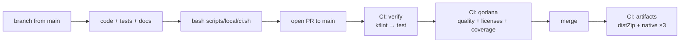

# Development workflow

How a change goes from an idea to `main`: branching, local checks, CI, and review.
For the hands-on dev loops (backend with Postgres, frontend with hot reload), see
[`CONTRIBUTING.md`](../../CONTRIBUTING.md#development-environment).

## The flow



## Step by step

1. **Branch from `main`.** Name it after the kind of change: `feat/<topic>`, `fix/<topic>`, `chore/<topic>`, `docs/<topic>`, `refactor/<topic>`. Some branches use a ticket id (`TCH-11`).
   > **TODO (owner to confirm):** the ticket system behind `TCH-*` ids, and whether ticket ids are expected in branch names or commit messages.
2. **Make the change in the right module.** Use [Repository structure → Where does my change go?](../structure.md#where-does-my-change-go).
3. **Test without the network.** Use `MockWebServer` for adapters and the substitutable seam for front-ends (see [Conventions → Testing](../conventions.md#testing)).
4. **Update docs in the same change** if you touched an invariant, a seam, the concurrency model, the layout, or the build ([Conventions](../conventions.md#commits-and-documentation)).
5. **Run the local CI mirror:**

   ```sh
   bash scripts/local/ci.sh            # all: ktlintCheck → test (same as CI `verify`)
   bash scripts/local/ci.sh lint       # just ktlint (fix with ./gradlew ktlintFormat)
   bash scripts/local/ci.sh tests      # tests + JaCoCo, prints report paths
   bash scripts/local/ci.sh full       # lint + tests + Qodana (needs Docker, Qodana CLI, QODANA_TOKEN)
   ```

   `QODANA_TOKEN` must be the **project** token from Qodana Cloud (project →
   Settings → Tokens), not an organization token.
6. **Commit with Conventional Commits:** `feat(core): …`, `fix(cli): …`, `docs: …`.
7. **Open a PR to `main`.** CI starts on `opened`, `reopened`, `synchronize`, and `ready_for_review`. A new push cancels the PR's in-flight run.
8. **Address the Qodana PR comment.** The scan runs in *fresh-code* mode (`pr-mode: true`), so it only reports issues in code you changed. A failing scan blocks the pipeline.
9. **Merge.** The merge becomes a push to `main`, which runs `verify` → `qodana` again and then builds the artifacts ([Release & artifacts](release.md)).

## What CI runs

Defined in [`.github/workflows/ci.yml`](../../.github/workflows/ci.yml).

| Job | When | Does | Gate |
|---|---|---|---|
| `verify` (Lint & Test) | every PR + push to `main`/`develop` + manual | `ktlintCheck`, then `test`. Uploads test reports (7 days) and JaCoCo XML (1 day). | — |
| `qodana` | after `verify` | Qodana JVM `qodana.recommended`, `CheckDependencyLicenses`, coverage from the JaCoCo artifact | needs `verify` |
| `distribution` | push only (= merged PR) | `:pixerion-cli:distZip` | needs `verify` + `qodana` |
| `native` | push only | `:pixerion-cli:nativeCompile` on Linux x86_64, macOS arm64, Windows x86_64 | needs `verify` + `qodana` |

> **Note:** `develop` is listed as a target branch but doesn't exist. That's a
> deliberate no-op until it does.

> **TODO (owner to confirm):** branch protection on `main`, the number of required
> reviewers, and whether `CODEOWNERS` is planned. The workflow comment assumes
> protection is in place ("Branch protection on main/develop is what makes 'push
> here' mean 'a PR was merged'"), but nothing in the repo records it.

## Review checklist

Reviewers look for these, roughly in order:

- [ ] Contract invariants intact (absence ≠ failure, cold/lazy download, one registry, one Java seam)
- [ ] Logic in `core`, front-ends thin
- [ ] Tests cover the miss and failure paths, not only the happy path, with no live network
- [ ] New dependencies are in the version catalog, native-image safe, and license-compatible
- [ ] `ARCHITECTURE.md`, the README, and this site are updated if behaviour or wiring changed
- [ ] An ADR exists if a real alternative was weighed

## IDE setup

IntelliJ run configurations are committed under [`.idea/runConfigurations/`](../../.idea/runConfigurations/):
`cli_main`, `server_localhost`, `http_api` (runs `api.http`), and `ci_localhost`
(runs the local CI script).

## Related

- [Release & artifacts](release.md)
- [Conventions](../conventions.md)
- [Troubleshooting](../troubleshooting.md)
- [Back to the hub](../index.md)
